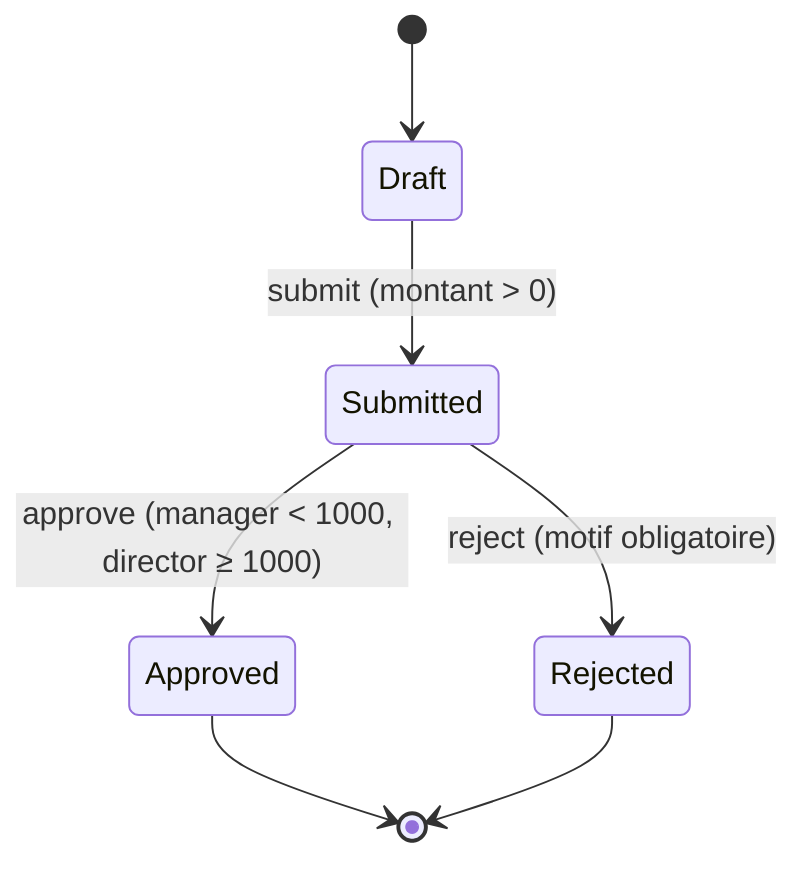
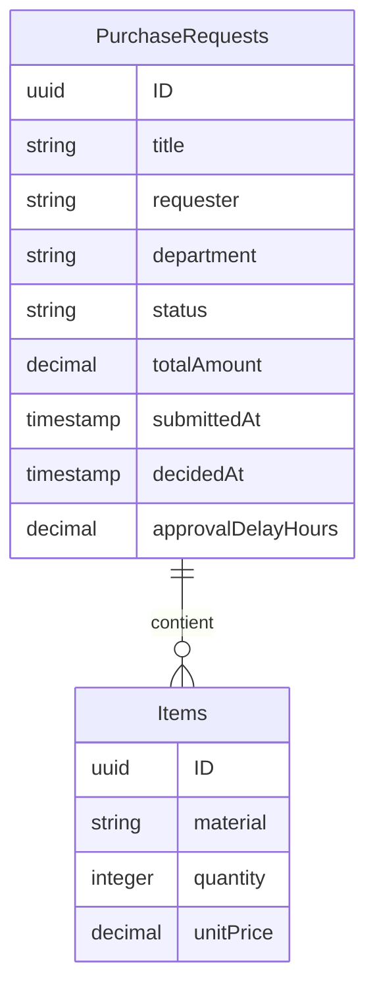

# Gestion des demandes d'achat avec workflow d'approbation

Application **SAP CAP (Node.js) + Fiori Elements** qui digitalise le processus de demande d'achat (Procure-to-Pay) : création de demandes, workflow d'approbation selon le montant, contrôle d'accès par rôle et tableau de bord analytique.

> Projet  : stack SAP moderne, orientée *Clean Core* (SAP CAP, OData V4, Fiori Elements).

---

## Problématique

Dans beaucoup d'entreprises, les demandes d'achat circulent par email et fichiers Excel : validations lentes, peu de traçabilité, aucune visibilité sur les délais. Cette application centralise le processus et rend chaque décision traçable et mesurable.

## Fonctionnalités

- **Demandes d'achat** avec lignes d'articles (article, quantité, prix unitaire)
- **Workflow à statuts** : `Draft` → `Submitted` → `Approved` / `Rejected`
- **Règle métier selon le montant** :
  - montant **< 1 000** : approbation par un *manager* (ou un *directeur*)
  - montant **≥ 1 000** : approbation par un *directeur* uniquement
- **Rejet avec motif obligatoire**
- **Calcul automatique** du montant total à partir des lignes
- **Délai d'approbation** calculé automatiquement (soumission → décision)
- **Statuts colorés** dans l'interface (orange / vert / rouge)
- **Dashboard** : demandes et montants par statut, montants et délai moyen par département
- **Tests automatisés** (Jest) couvrant les rôles et la machine à états

## Stack technique

| Couche | Technologie |
|---|---|
| Backend | SAP CAP (Node.js), CDS, OData V4 |
| Interface | SAP Fiori Elements (annotations CDS) |
| Base de données | SQLite en mémoire (développement) |
| Authentification | Utilisateurs simulés CAP (`mocked`) |
| Tests | Jest + `cds.test` |

## Workflow d'approbation



## Modèle de données



## Structure du projet

```
purchase-requests/
├── app/
│   └── annotations.cds      # Annotations UI (liste, détail, boutons, dashboard)
├── db/
│   ├── schema.cds           # Modèle de données
│   └── data/                # Données de test (CSV)
├── srv/
│   ├── service.cds          # Service OData, actions, entités statistiques
│   └── service.js           # Logique métier (workflow, rôles, calculs)
├── test/
│   └── approval.test.js     # Tests automatisés
├── docs/                    # Captures d'écran
└── package.json
```

## Prérequis

- [Node.js](https://nodejs.org) (version LTS)
- npm

## Installation et lancement

```bash
git clone https://github.com/TON_PSEUDO/purchase-requests-sap.git
cd purchase-requests-sap
npm install
npm run watch
```

L'application est disponible sur **http://localhost:4004**. La base est en mémoire et se recharge avec les données CSV à chaque démarrage.

| Écran | Accès |
|---|---|
| Demandes d'achat | `http://localhost:4004` → *Fiori preview* sur `PurchaseRequests` |
| Dashboard par statut | *Fiori preview* sur `StatusStats` |
| Dashboard par département | *Fiori preview* sur `DepartmentStats` |
| API OData | `http://localhost:4004/odata/v4/request/PurchaseRequests` |

## Utilisateurs de test

| Utilisateur | Mot de passe | Rôle | Droits |
|---|---|---|---|
| `alice` | `alice` | manager | Approuve/rejette les demandes < 1 000 |
| `bob` | `bob` | director | Approuve/rejette toutes les demandes |
| `omran` | `omran` | aucun | Crée et soumet ses demandes |

> Astuce : utiliser une fenêtre de navigation privée par utilisateur pour tester plusieurs rôles en parallèle.

## Scénario de démonstration

1. Connecté en `omran`, ouvrir « Licence logiciel » (statut *Draft*, 1 200) et cliquer sur **Soumettre**.
2. Connecté en `alice` (manager), tenter **Approuver** : refusé (**403**), le montant dépasse 1 000.
3. Connecté en `bob` (director), **Approuver** : le statut passe à *Approved* et le délai d'approbation est calculé.
4. Consulter le **dashboard** : les chiffres par statut et par département sont mis à jour.

## Tests

```bash
npm test
```

La suite vérifie notamment :

- un utilisateur sans rôle ne peut ni approuver ni rejeter ;
- un manager approuve < 1 000 mais pas ≥ 1 000 ;
- un directeur approuve toutes les demandes ;
- le délai d'approbation est calculé ;
- une double soumission est refusée ;
- un rejet exige un motif ;
- une demande rejetée ne peut plus être approuvée.

## Décisions de conception

- **Autorisation à deux niveaux** : le rôle minimum est déclaré dans le modèle (`@requires`), la règle fine du seuil de 1 000 est dans le code métier.
- **Calculs côté serveur** (montant total, délai) pour garantir la cohérence quel que soit le client.
- **Machine à états explicite** : chaque action refuse les transitions invalides, avec un message indiquant le statut actuel.
- **Annotations CDS** plutôt que code UI : interface générée par Fiori Elements, maintenable et conforme à l'approche *Clean Core*.

## Captures d'écran

| Liste des demandes | Page de détail |
|---|---|
|  |  |

| Dashboard par statut | Dashboard par département |
|---|---|
|  |  |

## Évolutions prévues

- [ ] Déploiement sur SAP BTP (SAP HANA Cloud, XSUAA, approuter)
- [ ] Application Fiori dédiée (SAP Fiori tools) avec page d'accueil
- [ ] Notifications des approbateurs
- [ ] Historique des décisions (audit)
- [ ] Intégration d'une API fournisseurs (SAP Business Accelerator Hub)

## Auteur

**Omrani-wiem** 
## Licence

Projet académique à usage pédagogique.